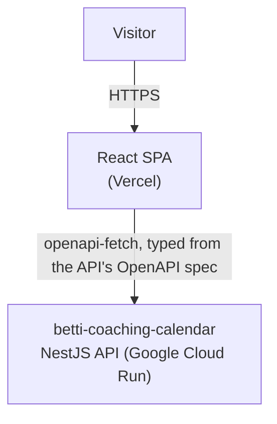

# Betti Coaching

Website for **Gerencsér Bernadett**, a family & couples communication coach based in Szeged, Hungary. A one-page marketing site (services, pricing, community, booking) plus a small admin dashboard, backed by a custom booking/calendar API — the sibling [betti-coaching-calendar](https://github.com/gerencserjani/betti-coaching-calendar) repo.

## System design



The public site and the admin dashboard are the same React app (`App.tsx`
routes `/admin/*` to a separately code-split bundle), both talking to the
backend over `VITE_API_URL`. There's no Cal.com and no mock calendar — the
booking wizard, slot picker, and admin's bookings/availability/event-types
pages all hit the real API.

## Tech stack

- **React 19** + **TypeScript**, **Vite** (dev server & build)
- **Tailwind CSS v4**
- **react-router-dom** — `/` (public site) vs `/admin/*` (dashboard), code-split
- **@tanstack/react-query** + **openapi-fetch** — data fetching, typed from the backend's own OpenAPI spec (`npm run generate:api-types`)
- **react-i18next** — Hungarian (default) / English. Fully implemented; the
  HU/EN switcher button is currently hidden from the header UI by request,
  but the mechanism stays live (`?lang=en`, `src/i18n/index.ts`) --
  `LanguageSwitcher.tsx` is unused but intact, ready to re-add.
- **react-phone-number-input** — booking form's phone field
- **@vercel/analytics** — Vercel Web Analytics (privacy-friendly, no cookie banner needed)
- **Vitest + Testing Library** — unit/component tests; **Playwright** — e2e
- **ESLint + Prettier + Husky/lint-staged** — linting & formatting on commit
- **semantic-release** — automated versioning and changelog from conventional commits, on every push to `main`

## Getting started

```bash
npm install
npm run dev       # start the dev server (expects the backend on localhost:3000)
npm run build     # type-check and build for production
npm run lint       # run ESLint
npm run preview    # preview the production build locally
```

The committed `.env` already has working localhost defaults — nothing to
copy for a basic `npm run dev`. To get Google Places autocomplete working
locally too, create `.env.local` (gitignored) with your own
`VITE_GOOGLE_PLACES_API_KEY` — see `.env.example` and "Environment
variables" below.

The booking wizard and admin dashboard need the backend running locally too
— see [betti-coaching-calendar](https://github.com/gerencserjani/betti-coaching-calendar)'s
own README for that setup.

## Project structure

```
src/
  admin/        admin dashboard: login, bookings, coaches, event types,
                availability, settings, Google Calendar connection status
  api/          typed API client (openapi-fetch + generated types)
  booking/      the public booking wizard (event type -> slot -> details -> confirm)
  components/   shared UI pieces (Header, Footer, ThemeToggle, icons, ...)
  sections/     one component per public-site section (Hero, Services, Pricing, Community, Booking, Contact, ...)
  hooks/        custom hooks (theme, scroll-spy, reveal-on-scroll)
  content/      site copy & data (nav links, pricing, community CTA, ...)
  i18n/         i18n setup and locale resources (hu/en)
  assets/       images, logo
  store/        small client-side state (e.g. theme)
  test/         Vitest setup + MSW mock server for component tests
e2e/            Playwright smoke tests (backend-independent)
scripts/        build-time scripts (robots.txt/sitemap.xml generation)
```

## Environment variables

See `.env.example` for the committed, non-secret defaults (`VITE_SITE_URL`,
`VITE_API_URL` -- both end up in the public client bundle anyway once
built, so there's nothing to hide there). One var needs a real value, kept
out of git:

- **`VITE_GOOGLE_PLACES_API_KEY`** — Google Places Autocomplete on the
  admin Settings page's business-address field. Put the real value in
  `.env.local` (gitignored) for local dev, and in the hosting platform's
  dashboard (Vercel) for production/preview. Restricted by HTTP referrer in
  Google Cloud Console. The address field falls back to a plain text input
  when this isn't set, so local dev works fine without it.
- **`VITE_SITE_URL`** — single source of truth for every absolute URL
  (canonical link, OG/Twitter tags, hreflang alternates, `sitemap.xml`,
  `robots.txt`). No trailing slash. Set in Vercel's dashboard for
  production; the committed `.env` default is the localhost dev value.
- **`VITE_API_URL`** — the backend's base URL.

## Testing

```bash
npm test              # unit/component tests (Vitest + Testing Library)
npm run test:coverage # same, with coverage
npm run test:e2e      # Playwright, against a running `npm run dev` on :5173
npm run test:e2e:ui   # Playwright's interactive UI mode
```

e2e tests are deliberately **backend-independent** smoke tests (homepage
loads, nav scrolls to a section, theme toggle, `?lang=en` switches text,
`/admin` redirects to login) — exercising the real booking/admin flows end
to end against a seeded backend is a separate CI infrastructure decision,
not done here yet.

## Project workflow

Work is tracked as [GitHub issues](https://github.com/gerencserjani/betti-coaching/issues) on the [project board](https://github.com/users/gerencserjani/projects/1), one issue per feature/section. This repo includes a few Claude Code slash commands to drive that workflow end to end:

- **`/start-issue <number>`** — creates a feature branch from a GitHub issue and moves it to "In Progress" on the board.
- **`/test-issue [number]`** — checks the current branch's changes against the issue's acceptance criteria (plus lint/build) and reports whether it's ready to ship.
- **`/end-issue [number]`** — runs `/test-issue` as a gate, then commits, pushes, opens a PR, and moves the issue to "Done" on the board.

Commit messages follow [Conventional Commits](https://www.conventionalcommits.org/) (`feat:`, `fix:`, `chore:`, ...) so `semantic-release` can version and release automatically.

## Deployment

Hosted on [Vercel](https://vercel.com), auto-deploying on every push to
`main` (`vercel.json` just has the SPA rewrite). Production/preview values
for `VITE_SITE_URL`, `VITE_API_URL`, and `VITE_GOOGLE_PLACES_API_KEY` are
set in Vercel's own dashboard, overriding the committed `.env`'s localhost
defaults during the Vercel build.
